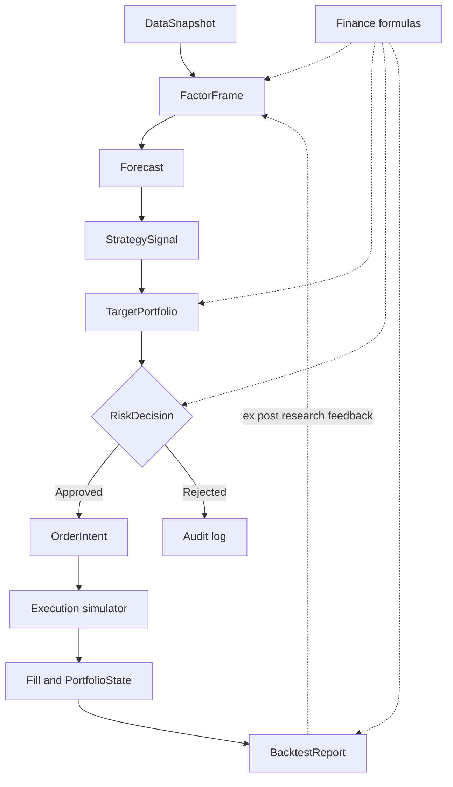

# nano-quant — 总体架构（Phase A）

状态：**设计基线 / 尚未实现**。版本：Architecture Baseline A1。

## 1. 使命与边界

构建可复现、可审计、模块化的量化金融研究框架；首先验证从数据到回测绩效的完整链路，而非承诺策略盈利。

v1.0 默认演示范围：Python 3.11+；**日频股票、单一基础货币 USD、无杠杆多头、不做真实交易**；使用有明确版本的合成测试数据实现完整链路。真实数据接入属于后续可选适配器，遵守数据授权与 point-in-time 语义。无套利衍生品定价、微秒级交易、实时券商接口、微服务和分布式训练不在 v1.0 范围。

## 2. 架构原则

1. **模块化单体**：一个仓库、一个 `nano_quant` Python 包，按领域划分，不拆分微服务。
2. **内核优先**：`core` 定义不可变业务对象、时间规则、货币与标识，禁止循环依赖。
3. **明确证据等级**：软件正确、金融数学正确、实验可复现、经济有效是四种不同结论。
4. **因果时间一致性**：任一决策仅能使用在决策时刻已经可用的信息；默认收盘计算，下一交易日开盘成交。
5. **风险是独立门禁**：策略提出意图，组合层给权重，风控层决定允许/拒绝；执行引擎不得绕过风险门禁。
6. **实验可重建**：发布结果包含 commit、数据 manifest、配置、环境、实验参数与评估基准。
7. **先做最小纵向闭环，再深化单个模块**：不要求 v1.0 实现所有高阶算法。

## 3. 八大领域与职责

| 编号 | 包 | 职责 | 典型输入 | 典型输出 |
| --- | --- | --- | --- | --- |
| 01 | `data` | 加载、时间对齐、溯源、质量校验 | 原始行情/元数据 | `DataSnapshot` |
| 02 | `finance` | 收益、现值、协方差、风险与绩效基础函数 | 数值序列、约定 | 数学结果 |
| 03 | `research` | 因子定义、IC、分组、研究报告 | `DataSnapshot` | `FactorFrame` |
| 04 | `models` | 训练与样本外预测 | 历史因子及标签 | `Forecast` |
| 05 | `strategies` | 把预测转换为可解释的交易偏好 | `Forecast` | `StrategySignal` |
| 06 | `portfolio` | 根据资金、持仓、约束配置目标权重 | 信号与当前状态 | `TargetPortfolio` |
| 07 | `risk` | 集中度、现金、可交易性及其他约束检查 | 目标权重/拟议订单 | `RiskDecision` |
| 08 | `execution` + `evaluation` | 模拟成交、账本、净值、绩效报告 | 已核准订单及市场事件 | `Fill`/`PortfolioState`/`BacktestReport` |

`finance` 是公共计算服务，`core` 是公共契约，不应让策略通过回测器内部状态偷看未来价格。

## 4. 数据与控制流



注意：在实际时间循环中，已知的 `PortfolioState` 也反馈至组合构建与风控；绩效反馈仅能影响**以后**的模型/策略版本，绝不可回填过去交易日的预测。

## 5. v1.0 标准示例

使用三只虚构股票与版本化合成日线，满足足够长的动量预热期；在约定月末收盘后计算 20 交易日动量，利用冻结或已完成时间序列训练的基准模型输出分数，选择最多两只股票等权，执行单标的权重上限、现金非负检查，并于**下一交易日开盘**按显式滑点与费用模拟成交，逐日计算 NAV 并出报告。

此示例验证系统运行和时间/会计正确性，**不构成**真实股票预测能力的证据。是否使用模型训练必须通过清楚标记的基准模型实现；禁止利用未来全区间拟合参数。

## 6. 技术路线与先后顺序

- v1.0：标准库 dataclass/typing；NumPy、pandas 用于数组与数据处理；Parquet 作为研究数据可选格式；pytest 为测试框架。固定 Python 和依赖版本，具体依赖版本在 Phase B 校验兼容性后决定。
- 先实现 Core → Data/Finance → Research/Models/Strategies → Portfolio/Risk → Execution/Evaluation。
- 后续版本可引入 statsmodels、scikit-learn、SciPy 优化器以及 DuckDB，但必须证明具体价值，不以依赖数量衡量成熟度。

## 7. 仓库目标结构（Phase B 开始创建）

```text
nano-quant/
  pyproject.toml
  README.md
  src/nano_quant/
    core/
    data/
    finance/
    research/
    models/
    strategies/
    portfolio/
    risk/
    execution/
    evaluation/
  tests/
    unit/
    integration/
    fixtures/
    golden/
  examples/
  docs/
    architecture/
      adr/
    governance/
    research/
    releases/
    validation/
  .github/workflows/
```

本阶段只交付设计文件；目录树不表示上述代码、CI 或测试已经存在。

## 8. 设计验收与追踪

接口定义：[`contracts.md`](contracts.md)；时间一致性：[`temporal-data.md`](temporal-data.md)；源数据证据：[`../research/evidence-policy.md`](../research/evidence-policy.md)；Git 治理：[`../governance/branching-and-releases.md`](../governance/branching-and-releases.md)；v1.0 范围：[`../releases/v1.0-plan.md`](../releases/v1.0-plan.md)；独立验收：[`../validation/acceptance.md`](../validation/acceptance.md)。
