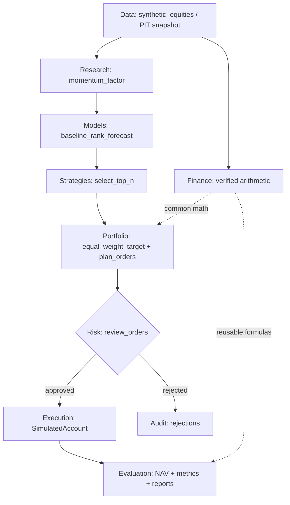

# Phase C 八模块实现与接口说明

状态：Phase C synthetic baseline。以下区分**已实现**与尚未实现的研究功能；不能把文档目标当成已经存在的代码。相关代码均在 `src/nano_quant/`。

## 1. 流程图



## 2. 公共时间与货币约定

- T 日 synthetic UTC 21:00 close 生成 bar，`available_at=21:01 UTC`，`as_of=21:02 UTC` 时才可进入研究。
- 在 T close 进行动量计算、选股、配置、订单提案、风险门禁；T+1 session **14:30 UTC** earliest open fill；T+1 close `available_at` 后 mark-to-market。
- `PriceBar` 的 open/close 均为**未复权**的合成价格；每条证券用固定内部 ID `SYNTH-A/B/C`；不支持 corporate actions。
- 所有现金与成交金额以 `Decimal` + USD cents 计算。信号排名分数也使用 Decimal，但**没有校准为预测收益率**。
- 用完整 fixture 和 `build_snapshot` 的 `available_at <= as_of` 过滤实现合成数据的 PIT 防泄露。下次交易日期的存在来自固定合成日历，不是把未来价格作为模型特征。
- `RiskDecision` 由独立策略生成，`SimulatedAccount.execute_at_open` 没有有效批准时拒单；真实购买力在下一开盘再检查。

## 3. Data：`data/synthetic.py` 与 `data/snapshot.py`

**输入**：`synthetic_equities(sessions=120)`；`build_snapshot(bars, as_of=UTC datetime, universe=...)`。

**输出**：确定性三标的 `PriceBar`、仅包含决策当时可得信息的 `DataSnapshot`。

**验证**：记录条数与排序、违规 OHLC/时间拒绝、未来价格扰动不影响 T 日数据快照。

**局限**：没有真实市场数据、历史股票池、退市、分红、数据授权与交易所真实时钟。

## 4. Finance：`finance/metrics.py`

**接口**：
- `simple_return(opening_value, closing_value, cash_distribution=0)`。
- `sample_covariance(x, y)`：同周期、严格对齐、样本分母 n−1。
- `sample_volatility(returns)`：样本标准差，保留原始收益期频率，不自动年化。
- `max_drawdown(nav)`：历史净值高点至后续低点的最大下降比例。

**验证**：独立手算简单含息收益、协方差、标准差、25% 最大回撤，并覆盖空输入、非有限值。

**局限**：当前不是完整资产定价、期权定价与风险因子库。

## 5. Research：`research/momentum.py`

**接口**：`momentum_factor(DataSnapshot, lookback_sessions=20) -> FactorFrame`。

**定义**：每只资产 `close[t]/close[t-20]-1`，需要至少 21 条历史收盘价；预热不足会显式拒绝，不以零填补。

**验证**：对照人工价格序列计算，检查后续未来价格变动不能改写过去因子。

**局限**：没有 IC、统计显著性、多因子检验或实证外部有效性分析。

## 6. Models：`models/baseline.py`

**接口**：`baseline_rank_forecast(FactorFrame) -> Forecast`。

**定义**：把当时已知的动量分数转成未校准的相对排序启发式。`training_cutoff=None` 表示**没有参数训练**。该输出不是上涨概率、可交易预期收益或经验证 Alpha。

**验证**：输入分数等于输出分数，模型版本与时间戳保持一致。

**局限**：没有拟合、滚动训练或预测误差统计；后续应建立科学可证伪的样本外预测实验。

## 7. Strategies：`strategies/ranking.py`

**接口**：`select_top_n(Forecast, top_n=2) -> tuple[StrategySignal, ...]`。

**定义**：按分数降序、instrument_id 升序打破并列；仅在合成月末触发调仓。

**验证**：确定性选择、数量上限和边界情况。

**局限**：不表示多策略组合或高级择时模型。

## 8. Portfolio：`portfolio/allocator.py`

**接口**：
- `equal_weight_target(signals, as_of, max_single_weight=.50, cash_buffer=.02) -> TargetPortfolio`
- `plan_orders(target, current_state, T_close_prices, next_open_time) -> tuple[OrderIntent,...]`

**定义**：确定带现金缓冲的等权、单标的受限目标；用 T 已知 close 计算整数股建议量。先卖后买。

**验证**：总权重不超过 1、单标的约束、目标时戳一致、缺少当前参考价明确失败。

**局限**：没有估计协方差、最大化目标函数或对冲约束，也不保证隔夜开盘必然足额成交。

## 9. Risk：`risk/policy.py`

**接口**：`review_orders(TargetPortfolio, OrderIntents, PortfolioState, max_single_weight, allowed_instruments) -> RiskDecision` 序列。

**定义**：独立检查集中度、时间一致性、重复订单 ID、可交易资产池、买单必须在目标内，以及不能卖空。

**验证**：违规订单包含机器可读拒绝原因；绕过审批的成交被账本拒绝。

**局限**：没有 VaR、压力测试、多因子风险估计或高级市场冲击限制；模拟执行阶段再次检查实际现金。

## 10. Execution / Evaluation：`execution/account.py`、`backtest.py`、`evaluation/performance.py`

**接口**：`SimulatedAccount.execute_at_open`、`mark_to_close`；`run_backtest(BacktestConfig)`；`write_report(...)`；`evaluate_nav(...)`。

**行为**：按合成月份决定调仓时间，在下一 session 开盘使用手续费和滑点模拟整数股交易；完整记账；输出 NAV、总收益、最大回撤与不计息现金对照基准。

**验证**：Phase B Golden Ledger A、现金不足、超量卖出、重复订单、下一开盘时间、费用敏感性、跨环境 CLI/报告产出和可复现性。

**局限**：全额成交或拒单，不支持部分成交、真实成交量冲击、分红、停牌、真实日历、融券或真实券商 API。

## 11. 复现命令

```bash
python -m pip install -e ".[dev]"
python -m pytest -q --cov=nano_quant --cov-report=term-missing --cov-fail-under=85
python -m nano_quant.cli backtest --config examples/daily_equity_v1.json --output-dir reports/daily_equity_v1
```

产物包含运行标识、原始合成数据哈希、版本/源码修订、交易账本、净值和结果。固定 **repo commit + config + synthetic fixture 版本 + Python/依赖环境** 才是严格复现条件；仅相同 run ID 不足以证明实盘表现。
